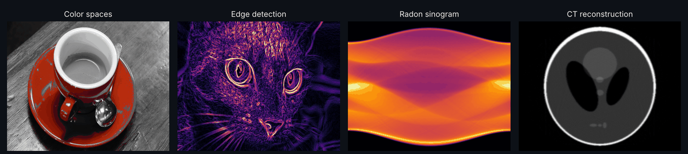
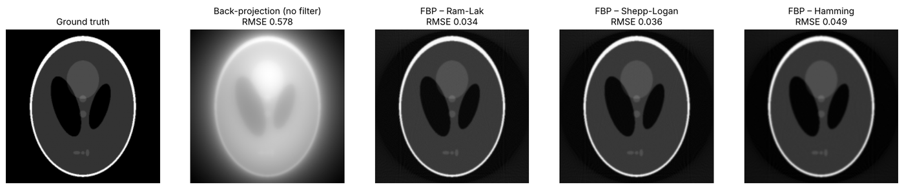
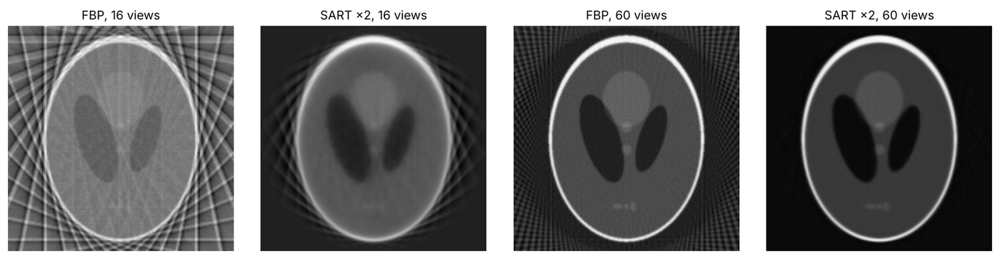
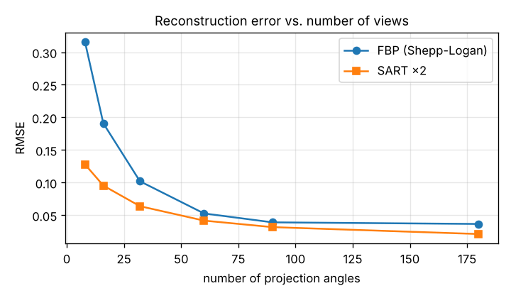
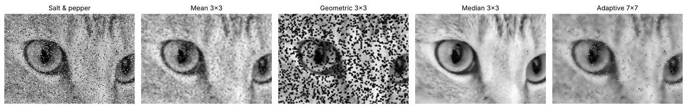
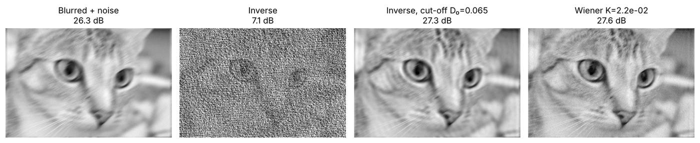
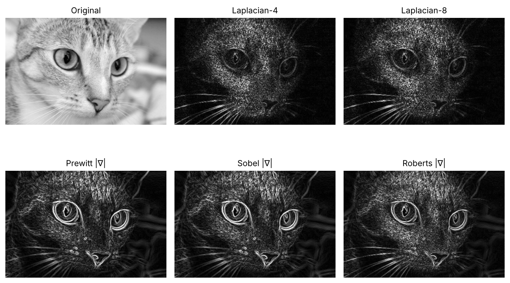
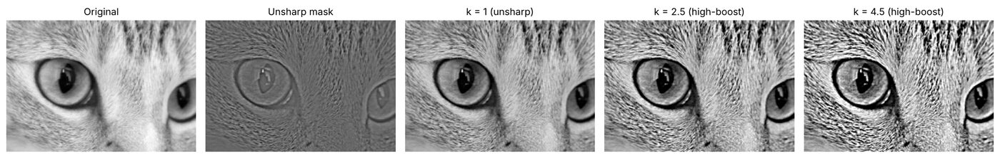
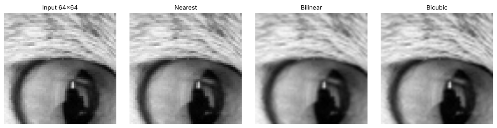
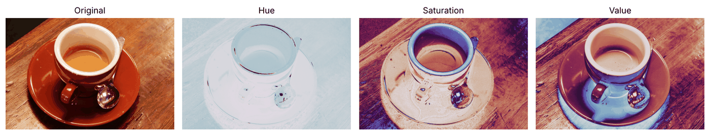

<div align="center">

# 🖼️ Digital Image Processing — from scratch

**Classic image-processing algorithms implemented from first principles in NumPy, each one checked against OpenCV, SciPy or scikit-image, with visual results for every chapter.**




</div>

---

## 📚 Chapters

| # | Notebook | What's inside | |
|:-:|---|---|:-:|
| 01 | [🎨 Color spaces](notebooks/01_color_spaces.ipynb) | RGB channel split · vectorised RGB→HSV (matches OpenCV within 1 level) · hue-based color splash | [](https://colab.research.google.com/github/negarsh76/Digital-Image-Processing/blob/main/notebooks/01_color_spaces.ipynb) |
| 02 | [🔍 Interpolation & rotation](notebooks/02_interpolation_and_rotation.ipynb) | Nearest / bilinear / bicubic (Keys kernel) resizing · rotation by inverse mapping · PSNR benchmark | [](https://colab.research.google.com/github/negarsh76/Digital-Image-Processing/blob/main/notebooks/02_interpolation_and_rotation.ipynb) |
| 03 | [✨ Spatial filtering](notebooks/03_spatial_filtering.ipynb) | Hand-written 2-D convolution · Laplacian, Sobel, Prewitt, Roberts · unsharp masking & high-boost | [](https://colab.research.google.com/github/negarsh76/Digital-Image-Processing/blob/main/notebooks/03_spatial_filtering.ipynb) |
| 04 | [🧹 Noise & restoration](notebooks/04_noise_and_restoration.ipynb) | Gaussian / salt-and-pepper / uniform noise · mean, geometric, median & adaptive filters · inverse vs. Wiener deblurring | [](https://colab.research.google.com/github/negarsh76/Digital-Image-Processing/blob/main/notebooks/04_noise_and_restoration.ipynb) |
| 05 | [🩻 Radon transform & CT](notebooks/05_radon_ct_reconstruction.ipynb) | Sinograms · filtered back-projection from scratch (Ram-Lak, Shepp-Logan, Hamming) · SART · sparse-view CT study | [](https://colab.research.google.com/github/negarsh76/Digital-Image-Processing/blob/main/notebooks/05_radon_ct_reconstruction.ipynb) |

Every notebook runs on its own using the sample images bundled with scikit-image, so there's nothing to download and no Google Drive to mount.

---

## 🩻 Highlight: CT reconstruction from scratch



Our FBP implementation reaches an RMSE of **0.034** on the Shepp–Logan phantom, compared with **0.025** for `skimage.iradon`. Plain back-projection, with no filter, scores **0.58**. The sparse-view experiment shows why iterative methods matter for low-dose CT:

<p align="center">
  
  
</p>

## 🧹 Highlight: picking the right denoiser

| Filter | Gaussian σ = 0.08 | Salt & pepper 10 % | Uniform ±0.2 |
|---|:-:|:-:|:-:|
| *(noisy input)* | 21.94 dB | 15.68 dB | 18.75 dB |
| Mean 3×3 | 29.35 dB | 24.29 dB | 27.12 dB |
| Geometric mean 3×3 | 28.79 dB | 10.72 dB | 26.34 dB |
| Median 3×3 | 28.08 dB | **33.15 dB** | 23.96 dB |
| Adaptive 7×7 | **29.57 dB** | 24.13 dB | **28.41 dB** |



Naive inverse filtering amplifies noise until the image is unusable. Wiener filtering does not:



## ✨ More results

<table>
<tr><td></td><td></td></tr>
<tr><td align="center">Edge detectors</td><td align="center">Unsharp masking → high-boost</td></tr>
<tr><td></td><td></td></tr>
<tr><td align="center">×4 zoom: nearest · bilinear · bicubic</td><td align="center">RGB → HSV</td></tr>
</table>

---

## 🚀 Run locally

```bash
git clone https://github.com/negarsh76/Digital-Image-Processing.git
cd Digital-Image-Processing
pip install -r requirements.txt
jupyter lab notebooks/
```

Or click any **Open in Colab** badge above.

## 📖 Reference

The chapters loosely follow *Digital Image Processing* (Gonzalez & Woods, 3rd ed.) and started as coursework for my M.Sc. in AI & Robotics. They have since been rewritten, cleaned up and validated.

## 📄 License

MIT

---

<p align="center">Made by <a href="https://github.com/negarsh76">Negar Shojaei</a> · AI researcher in medical imaging</p>
